## Sobre mim

- Desenvolvo sistemas de gestão financeira e fiscal sob medida para escritórios de contabilidade e seus clientes.
- Trabalho de ponta a ponta: modelagem de dados, APIs, interfaces web e infraestrutura.
- Experiência com integrações bancárias, documentos fiscais eletrônicos e automação de cobrança.
- Acompanho de perto a reforma tributária (IBS/CBS) e seus impactos nos sistemas.

## Tecnologias

> ### Frontend

> ### Backend

> ### Banco de dados

> ### DevOps

> ### Ferramentas

## Projetos em destaque

> Repositórios privados. As descrições abaixo são gerais.

- **ERP financeiro multiempresa** — contas a pagar e receber, conciliação bancária (OFX e APIs de bancos), DRE e fluxo de caixa, emissão de boletos e Pix integrados a bancos e régua de cobrança por WhatsApp.
- **Emissão de NFS-e no padrão nacional** — já adaptada ao IBS/CBS da reforma tributária, com assinatura digital de XML e integração com as APIs do governo.
- **Integrações** — Omie, Open Finance, Meta WhatsApp Business e Metabase.
- **Painéis e processamento fiscal** — painéis de clientes e comercial, e serviços de processamento de XML fiscal em Go + PostgreSQL.

## 🔗 Contato

Painéis gerados por <code>scripts/gerar.py</code> e atualizados todo dia por uma GitHub Action.
